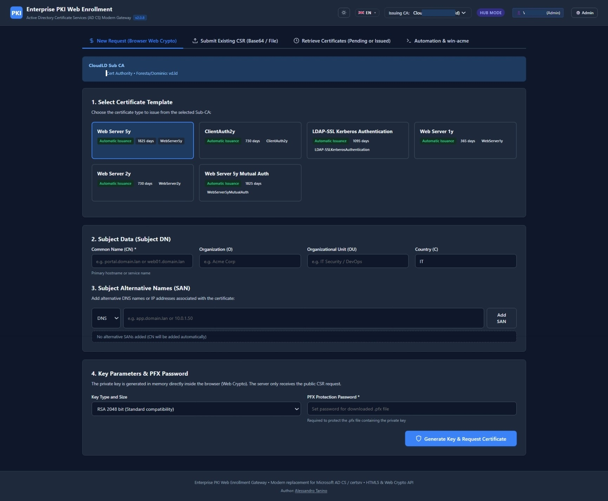
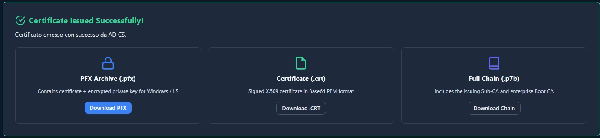
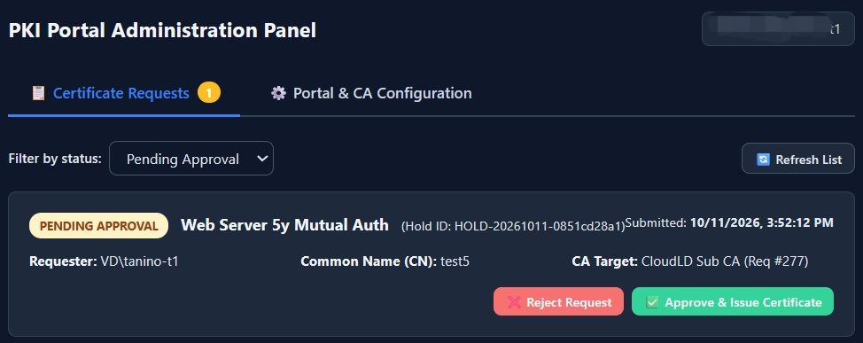
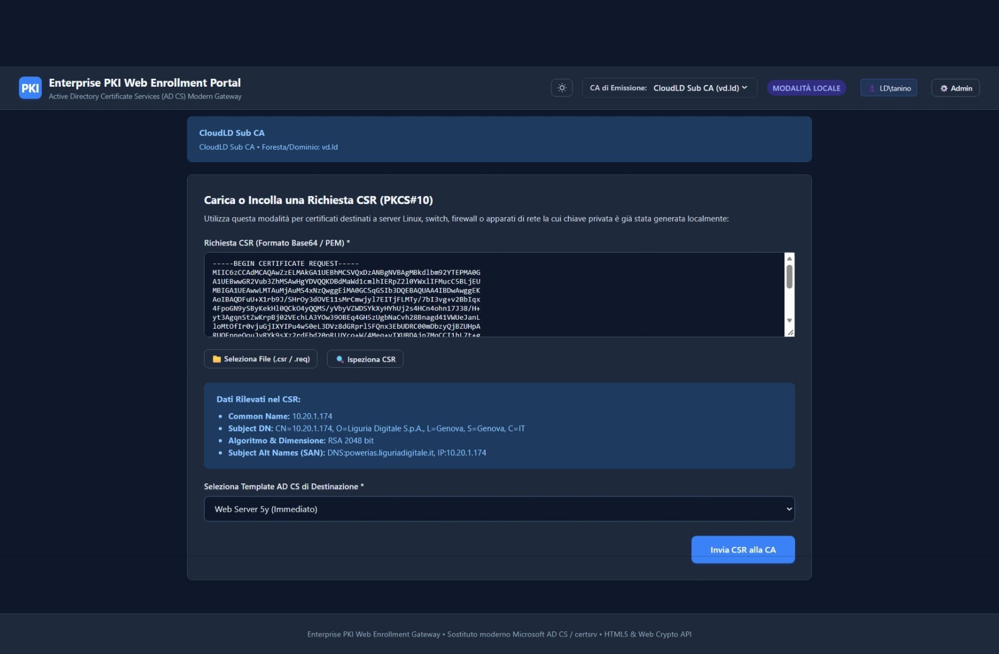
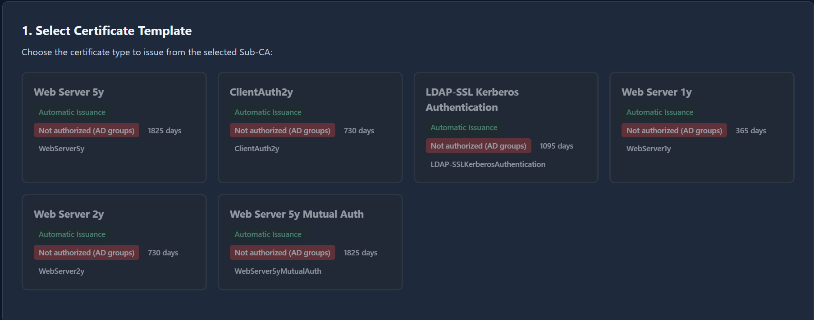
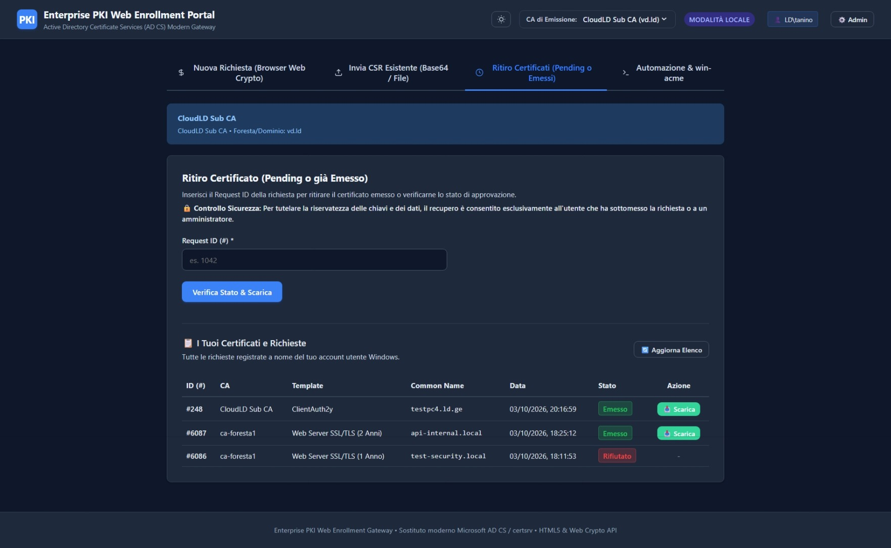

[🇮🇹 Italiano](README.it.md) | [🇬🇧 English](README.md)

# Enterprise PKI Web Enrollment Portal (AD CS Modern Gateway)

Portale web moderno in **HTML5** e **ASP.NET Core 8 (C#)** progettato per sostituire l'obsoleto e deprecato **Microsoft Web Enrollment (`certsrv`)**, eliminando qualsiasi dipendenza da ActiveX/Internet Explorer e mitigando i rischi di sicurezza NTLM Relay (ESC8).

---

## 🌟 Caratteristiche Principali

1. **Generazione Chiavi Client-Side e Custodia Cifrata a Riposo (HTML5 Web Crypto)**:

   * La coppia di chiavi (RSA 2048/3072/4096 o ECC P-256/P-384) viene generata in memoria direttamente all'interno del browser (`window.crypto.subtle`).
   * Quando si utilizza il **Wizard del portale**, per consentire il ritiro posticipato, il workflow di approvazione amministrativa (Hold & Review) e la generazione dell'archivio PKCS#12 (.pfx), la chiave privata viene trasmessa su canale sicuro HTTPS e **custodita sul server rigorosamente cifrata a riposo** tramite DPAPI machine-scope (`CRYPTPROTECT_LOCAL_MACHINE` con entropia a 256 bit) e AES-256-GCM nella cartella protetta `App_Data/held-requests.json`. La chiave privata **non viene mai salvata in chiaro sul server**.
   * Quando si utilizza la scheda **Caricamento CSR Esistente** (o l'automazione REST via CSR), la chiave privata risiede unicamente sulla macchina richiedente e non tocca mai il server.
   * All'emissione del certificato da parte di AD CS, viene generato il pacchetto **PKCS#12 (.pfx)** protetto da password scelta dall'utente, pronto per essere installato su Windows/IIS.
2. **Caricamento CSR Esistente (Base64 / File)**:

   * Supporto per file `.csr` / `.req` generati esternamente (es. server Linux, firewall, switch, apparati di rete).
   * Parsing e ispezione istantanea dei campi del CSR (Subject, SAN, Algoritmo, Dimensione chiave) prima dell'invio.
3. **Architettura Ibrida per Foreste Non Trustate**:

   * **Modalità Standalone (Affiancata a MSCS)**: Installata localmente all'interno di ciascuna foresta, dialoga con la Sub-CA locale senza alcuna modifica firewall cross-forest.
   * **Modalità Hub Multi-CA (DMZ Interna)**: Unico portale esposto in DMZ che consente all'utente di selezionare la CA di destinazione corretta dal menu a tendina.
4. **Integrazione Nativa Microsoft AD CS**:

   * Connessione ad altissime prestazioni tramite l'interfaccia COM Microsoft `CCertRequest` (`CertificateAuthority.Request` da `certcli.dll`).
   * Fallback automatico su `certreq.exe` CLI.
   * Simulatore integrato per sviluppo, test e ambienti offline (attivabile con `"UseSimulator": true`).
5. **Ritiro Sicuro dei Certificati (Pending o già Emessi)**:

   * Permette il recupero del certificato emesso inserendo il *Request ID* o visualizzando la propria tabella *"I Tuoi Certificati"*.
   * **Controllo di proprietà e sicurezza**: il download è consentito esclusivamente all'utente Windows che ha inviato la richiesta originale (`ctx.User.Identity.Name`) o agli amministratori, prevenendo qualsiasi accesso non autorizzato ai certificati altrui (HTTP 403 Forbidden).
6. **Workflow di Approvazione Manuale (Hold & Review)**:

   * Possibilità di impostare `RequiresApproval: true` sui template sensibili.
   * Il certificato generato e la relativa chiave privata (per rigenerare il pacchetto PFX) vengono trattenuti dal portale cifrati a riposo in `App_Data/held-requests.json` in stato `PendingApproval` e rilasciati all'utente solo dopo l'autorizzazione di un amministratore.
   * Gli utenti possono allegare **note opzionali** alle proprie richieste per fornire contesto agli amministratori.
7. **Controllo Accessi Basato sui Ruoli (RBAC sui Template)**:

   * Assegnazione granulare dei template a specifici gruppi Active Directory (`AllowedGroups`). Gli utenti non appartenenti ai gruppi autorizzati non possono emettere con tali template.
8. **Interfaccia Multilingua & Tema Chiaro/Scuro**:

   * Supporto completo per 5 lingue (**Italiano, Inglese, Francese, Tedesco, Spagnolo**) con cambio dinamico istantaneo.
   * Selezione tema Chiaro/Scuro persistente in memoria locale.
9. **REST API per Automazione (win-acme / PowerShell)**:

   * Espone endpoint RESTful per integrare script di rinnovo automatico e client di automazione come `win-acme`.

---

## 📸 Screenshot

### Portale Utente - Nuova Richiesta Certificato



### Portale Utente - Emissione Automatica & Download PFX



### Admin Utente - Richiesta in Attesa di Approvazione



### Portale Utente - Ritiro Certificati & Storico Utente



### Portale Utente - Template con Accesso Limitato (Gruppi AD)



### Pannello Amministrazione - Configurazione Portale, CA & Richieste Trattenute



---

## 📁 Struttura del Progetto

```text
Portale/
├── Models/
│   ├── AdminConfig.cs           # Configurazione autorizzativa amministratori
│   ├── HeldCertificateRequest.cs# Modello e stati delle richieste trattenute
│   ├── PortalConfig.cs          # Modelli di configurazione CA e Template
│   └── EnrollmentDto.cs         # DTO per richieste/risposte e parsing CSR
├── Services/
│   ├── IHeldRequestStore.cs     # Interfaccia archivio richieste trattenute
│   ├── HeldRequestStore.cs      # Store thread-safe con persistenza JSON
│   ├── IAdcsService.cs          # Interfaccia connettore AD CS
│   ├── AdcsService.cs           # Motore COM CCertRequest + certreq.exe + Simulatore
│   └── CsrParserService.cs      # Servizio di parsing CSR X.509
├── wwwroot/
│   ├── css/styles.css           # UI moderna responsive con supporto Dark/Light
│   ├── js/
│   │   ├── vendor/forge.min.js  # Libreria crittografica per PFX/ASN.1
│   │   ├── crypto-helper.js     # Generazione chiavi e PFX client-side
│   │   ├── i18n.js              # Modulo multilingua (IT, EN, FR, DE, ES)
│   │   └── app.js               # Controller applicativo e gestione form
│   ├── index.html               # Portale utente HTML5/SPA
│   └── admin.html               # Pannello amministrativo (Configurazione & Hold)
├── appsettings.json             # Configurazione CA, Template, RBAC e modalità Hub/Standalone
├── Program.cs                   # Entry point e Minimal API
├── web.config                   # Configurazione IIS (ASP.NET Core Module V2)
├── Add-CaCredential.ps1         # Gestione sicura credenziali cross-forest (Credential Manager)
├── Install-PkiPortal.ps1        # Script di installazione su IIS (a fianco di certsrv)
├── Uninstall-PkiPortal.ps1      # Script di disinstallazione pulita
└── run.ps1                      # Script rapido di avvio in sviluppo
```

---

## 🖥️ Installazione su IIS (a fianco di certsrv)

Lo script `Install-PkiPortal.ps1` installa il portale come **sito IIS separato** sullo stesso server
dove è attivo Microsoft Web Enrollment (certsrv), **senza modificare né interrompere certsrv**.

### Cosa fa lo script di installazione:

1. Verifica e installa le feature IIS necessarie (senza toccare quelle di certsrv).
2. Verifica/installa il .NET 8 ASP.NET Core Hosting Bundle.
3. Compila e pubblica l'applicazione nella cartella di destinazione.
4. Crea un **Application Pool dedicato** (separato da DefaultAppPool/certsrv).
5. Crea un **nuovo sito IIS** su porta e hostname configurabili.
6. Configura permessi file system (**FullControl** per l'Application Pool su tutta la cartella di deploy) e gestisce la configurazione iniziale (rinomina automatica di `appsettings.example.json` in `appsettings.json` se non già presente).
7. Configura la regola Windows Firewall e verifica che certsrv resti inalterato e funzionante.

### Prerequisiti

* Windows Server 2016 o successivo con ruolo IIS
* Privilegi di amministratore locale
* .NET 8 SDK (per la compilazione) o .NET 8 Hosting Bundle (per il solo runtime)
* **Certificato SSL / Binding HTTPS (Fortemente raccomandato / Requisito per client remoti)**: Per policy di sicurezza W3C (*Secure Context*), le Web Crypto API e i Web Worker nel browser richiedono connessione HTTPS (o `localhost`) per generare le chiavi crittografiche nel client. In HTTP puro su FQDN/IP remoti la generazione client-side viene bloccata dai browser.

### Esempi di installazione

```powershell
# Installazione base: sito HTTP sulla porta 8443
.\\Install-PkiPortal.ps1

# Installazione con gMSA (Group Managed Service Account - nessuna password richiesta)
.\\Install-PkiPortal.ps1 -SitePort 8443 -AppPoolIdentity "DOMAIN\\gmsa$" -IsGMSA

# Installazione HTTPS con hostname personalizzato e account utente standard
.\\Install-PkiPortal.ps1 -SitePort 443 `
    -SiteHostHeader "pki.azienda.lan" `
    -UseHttps `
    -CertThumbprint "A1B2C3D4E5F6..." `
    -AppPoolIdentity "DOMINIO\\svc-pki-portal" `
    -AppPoolPassword (Read-Host -AsSecureString "Password")

# Installazione su porta custom con nome sito personalizzato
.\\Install-PkiPortal.ps1 -SiteName "PKI-Enrollment-F1" -SitePort 9443

# Installazione senza regola firewall (ambienti gestiti centralmente)
.\\Install-PkiPortal.ps1 -SitePort 8443 -SkipFirewall
```

### Parametri disponibili

|Parametro|Default|Descrizione|
|-|-|-|
|`-SiteName`|`PkiWebEnrollment`|Nome del sito IIS|
|`-SitePort`|`8443`|Porta TCP di ascolto|
|`-SiteHostHeader`|*(vuoto = tutti)*|Hostname specifico (es. `pki.azienda.lan`)|
|`-InstallPath`|`C:\\inetpub\\PkiWebEnrollment`|Cartella di pubblicazione|
|`-AppPoolIdentity`|`ApplicationPoolIdentity`|Identità del pool (`NetworkService`, `LocalSystem`, `DOMINIO\\Account$` o `DOMINIO\\User`)|
|`-AppPoolPassword`|*(nessuna)*|Password per account utente di dominio standard (non necessaria per gMSA)|
|`-IsGMSA`|*(no)*|Specifica che l'identità è un gMSA (senza password, aggiunge `$` se mancante)|
|`-UseHttps`|*(no)*|Abilita binding HTTPS|
|`-CertThumbprint`|*(nessuno)*|Thumbprint del certificato SSL|
|`-SourcePath`|*(directory corrente)*|Percorso del progetto sorgente|
|`-SkipDotnetPublish`|*(no)*|Salta la compilazione (usa file già pubblicati)|
|`-SkipFirewall`|*(no)*|Non crea la regola firewall|

### Disinstallazione

```powershell
# Rimuove sito IIS, app pool e regola firewall (conserva i file)
.\Uninstall-PkiPortal.ps1

# Rimuove tutto inclusi i file applicativi
.\Uninstall-PkiPortal.ps1 -RemoveFiles
```

> **⚠️ Garanzia di non intrusività**: Entrambi gli script operano esclusivamente sul sito
> e sull'app pool dedicato al portale PKI. Il sito "Default Web Site" e l'applicazione
> `/CertSrv` **non vengono mai toccati né modificati**.

---

## ⚙️ Configurazione con le Vere Sub-CA

Modificare il file `appsettings.json` (nella cartella di installazione, es. `C:\\inetpub\\PkiWebEnrollment\\appsettings.json`):

### 1\. Modalità Locale (Installazione a fianco di certsrv nella stessa foresta)

In questa modalità non serve alcuna configurazione di credenziali: il portale usa l'identità dell'App Pool IIS (`AuthMode: "LocalIdentity"`).

```json
{
  "PortalConfig": {
    "PortalMode": "Standalone",
    "PortalTitle": "Enterprise PKI Web Enrollment Portal",
    "DefaultCaId": "ca-foresta1",
    "CAs": [
      {
        "Id": "ca-foresta1",
        "DisplayName": "Foresta 1 - Enterprise Issuing CA (Prod)",
        "ForestOrDomain": "foresta1.lan",
        "ConfigString": "subca01.foresta1.lan\\Foresta1-SubCA",
        "IsDefault": true,
        "UseSimulator": false,
        "AuthMode": "LocalIdentity",
        "Templates": [ ... ]
      }
    ]
  }
}
```

### 2\. Modalità Hub Centralizzata (In DMZ verso più foreste NON trustate)

In questa modalità il portale contatta ciascuna Sub-CA usando l'account di servizio specifico di quella foresta, memorizzato in **Windows Credential Manager** (**nessuna password salvata nei file di configurazione!**):

```json
{
  "PortalConfig": {
    "PortalMode": "Hub",
    "PortalTitle": "Enterprise PKI Web Enrollment Portal",
    "DefaultCaId": "ca-foresta1",
    "CAs": [
      {
        "Id": "ca-foresta1",
        "DisplayName": "Foresta 1 - Enterprise Issuing CA",
        "ForestOrDomain": "foresta1.lan",
        "ConfigString": "subca01.foresta1.lan\\Foresta1-SubCA",
        "IsDefault": true,
        "UseSimulator": false,
        "AuthMode": "CredentialManager",
        "CredentialTarget": "subca01.foresta1.lan",
        "Templates": [ ... ]
      },
      {
        "Id": "ca-foresta2",
        "DisplayName": "Foresta 2 - Enterprise Issuing CA (Non Trustata)",
        "ForestOrDomain": "foresta2.lan",
        "ConfigString": "subca02.foresta2.lan\\Foresta2-SubCA",
        "IsDefault": false,
        "UseSimulator": false,
        "AuthMode": "CredentialManager",
        "CredentialTarget": "subca02.foresta2.lan",
        "Templates": [ ... ]
      }
    ]
  }
}
```

---

## 🔐 Registrazione Sicura Credenziali (Windows Credential Manager)

Per registrare le credenziali degli account di servizio delle diverse foreste **senza mai scrivere password in chiaro**, utilizzare lo script incluso `Add-CaCredential.ps1`:

```powershell
# Registra l'account per la Sub-CA di Foresta 1 (la password viene chiesta con maschera protetta)
.\Add-CaCredential.ps1 -Target "subca01.foresta1.lan" -UserName "FORESTA1\\svc-pki-enroll"

# Registra l'account per la Sub-CA di Foresta 2 (foresta separata non trustata)
.\Add-CaCredential.ps1 -Target "subca02.foresta2.lan" -UserName "FORESTA2\\svc-pki-enroll"

# Visualizza i target registrati nel Credential Manager
.\Add-CaCredential.ps1 -List

# Rimuove una credenziale memorizzata
.\Add-CaCredential.ps1 -Target "subca02.foresta2.lan" -Remove
```

> **Come funziona sotto il cofano**:
> Quando arriva una richiesta per `ca-foresta2`, il backend interroga `Advapi32.dll` (`CredReadW`) per il target `subca02.foresta2.lan`, crea un token di rete sicuro tramite `LogonUser` (`LOGON32\_LOGON\_NEW\_CREDENTIALS`) ed esegue l'operazione (`CCertRequest` / `certreq`) in un blocco `WindowsIdentity.RunImpersonated`. Le chiamate RPC/DCOM verso la CA remota si presentano così con l'account di quella foresta, superando l'assenza di trust.

---

## 🚀 Avvio Rapido (Sviluppo Locale)

In una console PowerShell:

```powershell
.\run.ps1
```

Oppure manualmente:

```powershell
$env:PATH = "C:\\Program Files\\dotnet;$env:PATH"
dotnet run --urls "http://127.0.0.1:5055"
```

Quindi aprire il browser all'indirizzo **`http://127.0.0.1:5055`**.

---

## 🔒 Sicurezza e Best Practice

* **HTTPS e Contesto Sicuro (W3C Secure Context)**: In produzione, usare sempre HTTPS. Oltre alla cifratura del traffico e alla protezione delle sessioni, HTTPS è **indispensabile** affinché i browser moderni consentano l'esecuzione sicura dei Web Worker (Blob URL) e delle API crittografiche per la generazione client-side delle chiavi private e dei CSR. Su HTTP puro (da IP o hostname remoto), i browser bloccano queste API o provocano blocchi/lentezza estrema.
* **Service Account**: L'Application Pool di IIS deve eseguire con un account che abbia i permessi *Request Certificates* (Enroll) sui template ADCS desiderati. Per la modalità Standalone all'interno della foresta, `NetworkService` o un Managed Service Account è sufficiente.
* **Separazione da certsrv**: Il portale utilizza un sito IIS e un Application Pool completamente separati, garantendo che un problema sul portale non impatti certsrv e viceversa.

### Hardening v2.1.0 / v2.1.1

A partire dalla **2.1.0** (e completato nella **2.1.1**) il portale applica le seguenti contromisure (dettagli nel changelog):

* **HTTP in chiaro bloccato by default**: `Install-PkiPortal.ps1` senza `-UseHttps` si arresta con errore; l'override `-AllowInsecureHttp` è riservato ad ambienti di test isolati. Il portale imposta inoltre `Strict-Transport-Security` (HSTS).
* **Extended Protection for Authentication (EPAL)**: lo script di installazione configura `windowsAuthentication` con `extendedProtection:outbound` (protezione da NTLM relay); l'autenticazione anonima su IIS è **disabilitata**, quindi anche `/admin.html` e i file statici richiedono il challenge NTLM/Kerberos.
* **Minimo privilegio sull'installazione**: l'identità dell'App Pool riceve `ReadAndExecute` sui binari (niente più `FullControl`: impedisce il DLL swap) e `Modify` solo su `appsettings.json`, `App_Data` e `logs` (cartelle blindate con ACL esclusive).
* **Content-Security-Policy**: header CSP restrittiva in `web.config` (solo same-origin, nessun script inline: preloader del tema e handler sposti in `js/theme-init.js` e nel bundle del pannello admin).
* **Chiave privata: invio al server solo quando necessario**: nei flussi a emissione immediata la chiave privata **non lascia il browser**; viene trasmessa al portale (su HTTPS, custodita cifrata a riposo con DPAPI/AES-GCM) solo per i template con `RequiresApproval`, per il ritiro differito del PFX. La password del PFX è **obbligatoria** in tutti i flussi e il PFX usa **AES-256-CBC** (più 3DES). La generazione delle chiavi richiede il CSPRNG nativo del browser (`window.crypto.getRandomValues`): in contesti non sicuri (HTTP da host remoto) la generazione viene rifiutata.
  - **Nota di configurazione**: se un template ha approvazione manuale *a livello CA* (richiesta lasciata in Pending dalla CA), impostare `RequiresApproval: true` nella configurazione del portale, così che la chiave venga custodita per il ritiro.
* **Anti-CSRF per sessione**: gli endpoint mutanti admin richiedono un token legato all'identità (`HMAC-SHA256`, 30 minuti, emesso da `GET /api/admin/csrf`) nell'header `X-Pki-Portal-Admin`; il valore statico pubblico della 2.0.x non è più accettato.
* **Rate limiting per identità**: 5 req/min su `/api/certificates/request`, 20 req/min su `/api/certificates/parse-csr`, 120 req/min di default (rifiuto HTTP 429).
* **LDAPS per la lettura dei template AD**: la query di validità dei template usa LDAPS (636); con credenziali esplicite (modalità Hub) nessun fallback in chiaro.
* **Nessuna password in command line**: `Add-CaCredential.ps1` usa il prompt interattivo di `cmdkey` (`/pass:` vuoto) — la password non compare in variabili, command line o log.
* **Nessuna divulgazione di informazione**: `/api/config` non espone più i nomi dei gruppi AD a ogni utente autenticato (solo `IsAllowed`); gli errori admin non restituiscono i dettagli delle eccezioni.


---

## 🛡️ Pannello amministrativo e richieste in approvazione

Il portale include `/admin.html`, protetto da Windows Authentication e da una ACL configurabile nella sezione `AdminConfig` di `appsettings.json`. Gli utenti autorizzati sono definiti tramite `AllowedGroups` e `AllowedUsers`; gli altri ricevono `HTTP 403 Forbidden`.

```json
{
  "AdminConfig": {
    "AllowedGroups": [
      "BUILTIN\\Administrators",
      "CONTOSO\\Domain Admins"
    ],
    "AllowedUsers": [
      "CONTOSO\\user-adm"
    ]
  }
}
```

### Workflow di approvazione manuale (Hold & Review)

Quando un template ha `RequiresApproval: true`:

1. L'utente invia la richiesta tramite Web Crypto o CSR esterno.
2. AD CS elabora la richiesta ed emette tecnicamente il certificato.
3. Il portale intercetta il certificato, lo archivia con la chiave privata cifrata a riposo in `App_Data/held-requests.json` e contrassegna la richiesta come `PendingApproval`.
4. L'utente riceve un Hold ID univoco e viene informato che la richiesta è in attesa di approvazione.
5. Il certificato non può essere scaricato finché un amministratore autorizzato non lo approva dal pannello admin.

Dopo l'approvazione, il certificato diventa scaricabile dal richiedente originale tramite la sezione di ritiro certificati. Gli amministratori possono inoltre rifiutare la richiesta registrando una motivazione.

### Stati delle richieste trattenute

|Stato|Descrizione|Azione disponibile|
|-|-|-|
|`PendingApproval`|Certificato trattenuto in attesa di autorizzazione amministrativa.|Approva e rilascia, oppure Rifiuta.|
|`Approved`|Richiesta approvata da un amministratore.|Download del certificato abilitato per il richiedente.|
|`Issued`|Certificato emesso direttamente (template senza approvazione).|Download diretto abilitato.|
|`UnderSubmission`|Richiesta in sospeso sulla CA AD CS stessa (richiesta marcata Pending dalla CA).|Visualizza stato richiesta.|
|`Rejected`|Richiesta rifiutata da un amministratore.|Visualizza motivazione del rifiuto.|

### Endpoint amministrativi

|Metodo|Endpoint|Descrizione|Autorizzazione|
|-|-|-|-|
|GET|`/api/admin/check`|Verifica se l'utente corrente è amministratore|Utente autenticato|
|GET|`/api/admin/csrf`|Emette il token anti-CSRF legato all'identità (2.1.0)|Amministratore|
|GET|`/api/admin/config`|Legge l'intera configurazione del portale|Amministratore|
|PUT|`/api/admin/config`|Salva la configurazione e ricarica il provider a caldo|Amministratore|
|POST|`/api/admin/templates/discover`|Scopre i template pubblicati sulla CA tramite DCOM o LDAP|Amministratore|
|GET|`/api/admin/held-requests?status={filter}`|Elenca le richieste trattenute (`pending`, `approved`, `rejected`, `all`)|Amministratore|
|GET|`/api/admin/held-requests/{holdId}`|Mostra il dettaglio di una richiesta e il certificato archiviato|Amministratore|
|POST|`/api/admin/held-requests/{holdId}/approve`|Approva e autorizza il rilascio del certificato|Amministratore|
|POST|`/api/admin/held-requests/{holdId}/reject`|Rifiuta la richiesta con motivazione opzionale|Amministratore|

## 🔎 Scoperta dei template e validità

La funzione di discovery legge dalla definizione del template AD CS l'attributo `pKIDefaultLifetime` tramite Active Directory e converte il valore in giorni. In modalità Hub, la query usa le credenziali della foresta di destinazione; se LDAP non è disponibile, viene usato il fallback:

```powershell
certutil -config "server\\CA" -template NomeTemplate
```

La validità viene salvata in `appsettings.json` e mostrata in sola lettura all'amministratore. Per le CA in modalità simulatore, la validità è tratta dalle definizioni mock.

---

## 🔑 RBAC sui Template (Controllo Accessi per Gruppo)

L'accesso ai singoli template di certificato può essere limitato a specifici gruppi Active Directory tramite il campo `AllowedGroups` nella configurazione del template:

```json
{
  "Name": "WebServer-Secure",
  "DisplayName": "Web Server SSL/TLS (Solo Admins)",
  "Description": "Template riservato al gruppo PKI-Admins",
  "RequiresApproval": true,
  "ValidityDays": 365,
  "AllowedKeyTypes": ["RSA-2048", "RSA-4096"],
  "KeyUsages": ["DigitalSignature", "KeyEncipherment"],
  "ExtendedKeyUsages": ["ServerAuthentication"],
  "AllowedGroups": ["CONTOSO\\PKI-Admins"]
}
```

Quando `AllowedGroups` contiene uno o più gruppi, solo gli utenti appartenenti a tali gruppi possono visualizzare e utilizzare il template. Gli utenti non autorizzati vedranno il template disabilitato con un'icona lucchetto nell'interfaccia del portale.

---

## 🧪 Modalità Simulatore (Sviluppo e Test)

Per ambienti di sviluppo, test o demo offline, è possibile attivare il simulatore integrato impostando `"UseSimulator": true` sulla configurazione della CA:

```json
{
  "Id": "ca-test",
  "DisplayName": "CA Simulata (Test/Demo)",
  "ForestOrDomain": "test.local",
  "ConfigString": "simulator",
  "IsDefault": true,
  "UseSimulator": true,
  "AuthMode": "LocalIdentity",
  "Templates": []
}
```

Il simulatore:

* Genera certificati auto-firmati tramite l'API .NET `CertificateRequest`.
* Produce risposte PKCS#7 (P7B) realistiche con certificato emesso e Root CA simulata.
* Supporta template simulati con nomi, display name e validità predefiniti.
* Implementa completamente il workflow `RequiresApproval` (approvazione manuale).
* Non richiede alcuna infrastruttura AD CS né connettività di rete.

---

## 📡 Endpoint REST Utente

|Metodo|Endpoint|Descrizione|Autorizzazione|
|-|-|-|-|
|GET|`/api/cas`|Elenco delle CA configurate con i relativi template.|Utente autenticato|
|GET|`/api/templates/{caId}`|Elenco template per una CA specifica (filtro RBAC applicato).|Utente autenticato|
|POST|`/api/certificates/request`|Sottomissione CSR per firma (workflow Hold se configurato).|Utente autenticato|
|GET|`/api/certificates/status/{caId}/{requestId}`|Stato/ritiro certificato (controllo proprietà).|Autenticato (richiedente originale o amministratore)|
|GET|`/api/certificates/my-requests/{caId}`|Elenco ultime richieste dell'utente corrente.|Utente autenticato|

---

## 📋 Riferimento Configurazione Template

|Campo|Tipo|Default|Descrizione|
|-|-|-|-|
|`Name`|string|—|Nome di sistema del template in AD CS (es. `WebServer`).|
|`DisplayName`|string|—|Nome visualizzato all'utente.|
|`Description`|string|—|Breve descrizione mostrata nel portale.|
|`RequiresApproval`|bool|`false`|Se `true`, i certificati emessi vengono trattenuti per approvazione admin.|
|`ValidityDays`|int|`365`|Validità del certificato in giorni (sola lettura se scoperto dalla CA).|
|`AllowedKeyTypes`|string[]|`["RSA-2048","RSA-4096","ECDSA-P256"]`|Algoritmi chiave ammessi. Supporta anche `RSA-3072` e `ECDSA-P384`.|
|`KeyUsages`|string[]|`["DigitalSignature","KeyEncipherment"]`|Valori X.509 Key Usage.|
|`ExtendedKeyUsages`|string[]|`["ServerAuthentication"]`|OID/nomi X.509 Extended Key Usage.|
|`AllowedGroups`|string[]|`[]` (tutti)|Gruppi Active Directory autorizzati all'uso del template (RBAC).|

---

## 🛠️ Risoluzione dei Problemi (Troubleshooting)

### 1. Il browser resta bloccato su "Generazione Crittografica Locale"
* **Sintomo**: L'interfaccia mostra il cerchio di caricamento e la dicitura *"Creazione della coppia di chiavi RSA/ECC nel browser..."* senza avanzare.
* **Causa**: Il portale è stato aperto tramite protocollo HTTP non sicuro su un IP o nome host remoto (es. `http://nomeserver:81/`). I browser web applicano le specifiche W3C Secure Contexts, che limitano o bloccano i Web Worker instanziati da Blob URL e le relative API crittografiche se non ci si trova sotto HTTPS (o `localhost`).
* **Soluzione**:
  * Configurare il binding **HTTPS** su IIS associando un certificato SSL valido (parametro `-UseHttps -CertThumbprint` in `Install-PkiPortal.ps1`, oppure da IIS Manager).
  * Il client include inoltre un fallback di sicurezza: dopo 15 secondi di attesa dei Web Worker, passa automaticamente alla modalità single-thread garantendo il completamento.

### 2. Errore durante l'installazione: "Cannot find path 'IIS:\AppPools\...' because it does not exist"
* **Causa**: Nelle installazioni pulite su nuove macchine, lo script tentava di verificare lo stato del pool IIS prima della sua creazione.
* **Soluzione**: Gestito nello script `Install-PkiPortal.ps1` con controllo preventivo di esistenza `Test-Path`.

### 3. Permessi dell'Application Pool e prima installazione
* Lo script di installazione attribuisce automaticamente all'identità dell'Application Pool (`$identityAccount`, inclusi gMSA o utenti di dominio) i permessi di **FullControl** con ereditarietà su tutta la cartella `$InstallPath`.
* Se alla prima installazione il file `appsettings.json` non è presente, lo script provvede a rinominare in automatico `appsettings.example.json` in `appsettings.json`.

---

## 👤 Autore

**Alessandro Tanino** ([alessandro.tanino@hotmail.com](mailto:alessandro.tanino@hotmail.com))

---

## 📄 Licenza

Questo progetto è rilasciato sotto licenza [MIT](LICENSE).


